# Doctor Tracker — Clinical Management & Healthcare Analytics System

[](https://nextjs.org/)
[](https://react.dev/)
[](https://www.typescriptlang.org/)
[](https://expressjs.com/)
[](https://www.mongodb.com/)
[](https://tailwindcss.com/)
[](https://ui.shadcn.com/)
[](https://tanstack.com/query)

---

## 1. Elevator Pitch

**Doctor Tracker** is an enterprise-grade hospital and clinical administration platform built for clinical directors, hospital administrators, and medical staff to seamlessly manage physician networks and patient care registries. Featuring lightning-fast, index-backed prefix search, multi-faceted filtering, strictly enforced referential integrity, and an executive analytics dashboard powered by MongoDB aggregation pipelines and interactive Recharts visualizations, Doctor Tracker streamlines healthcare workflows with bank-grade security, dark mode accessibility, and complete mobile-first responsiveness.

---

## 2. Setup Guide

### Prerequisites
- **Node.js**: v20+ (tested on Node v24)
- **Package Manager**: npm v10+ (or pnpm/yarn)
- **Database**: MongoDB Atlas Connection String or local MongoDB v6+

### Quick Start

#### 1. Clone the Repository
```bash
git clone <repository-url>
cd doctor-tracker
npm install
```

#### 2. Backend Setup (`/server`)
```bash
cd server
cp .env.example .env
```
Configure your `.env` variables:
```env
NODE_ENV=development
PORT=5000
MONGODB_URI=mongodb+srv://<username>:<password>@cluster.mongodb.net/doctor_tracker
JWT_ACCESS_SECRET=your_super_secret_jwt_access_key_min_32_characters_long
JWT_REFRESH_SECRET=your_super_secret_jwt_refresh_key_min_32_characters_long
JWT_ACCESS_EXPIRES=15m
JWT_REFRESH_EXPIRES=7d
CLIENT_URL=http://localhost:3000
```
Seed the database and start the server:
```bash
npm run seed     # Synchronizes compound indexes, creates admin, 25 doctors, 400 patients
npm run dev      # Starts Express API at http://localhost:5000
```

#### 3. Frontend Setup (`/client`)
In a new terminal:
```bash
cd client
cp .env.example .env.local
```
Configure `client/.env.local`:
```env
API_URL=http://localhost:5000
NEXT_PUBLIC_APP_NAME=Doctor Tracker
```
Start the Next.js portal:
```bash
npm run dev      # Starts Next.js application at http://localhost:3000
```

#### 4. Demo Admin Credentials
Pre-seeded and ready for instant evaluation:
- **Email**: `admin@doctortracker.com`
- **Password**: `Admin@12345`
*(Click the "Quick Fill Demo Admin Credentials" button on the login screen for 1-click authentication)*

---

### Available Scripts Table

| Workspace | Command | Purpose |
|---|---|---|
| **Root** | `npm run dev` | Runs both server (`5000`) and client (`3000`) concurrently |
| **Root** | `npm run build` | Builds both server and client with strict TypeScript and Next.js optimization |
| **Root** | `npm run lint` | Runs ESLint across all backend and frontend packages |
| **Root** | `npm run seed` | Runs database seeder with weighted clinical distributions |
| **Server** | `npm run dev --workspace=server` | Starts Express server in watch mode with `tsx` |
| **Server** | `npm run build --workspace=server` | Compiles server TypeScript to `dist/` |
| **Server** | `npm run test --workspace=server` | Runs Vitest test suites (auth, doctor, patient, analytics, explain) |
| **Client** | `npm run dev --workspace=client` | Starts Next.js development server |
| **Client** | `npm run build --workspace=client` | Compiles optimized Next.js production build |

---

## 3. System Architecture

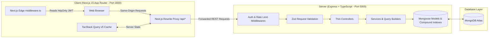

### Request Lifecycle
1. **Client Request**: Browser interacts with Next.js App Router. All API calls target `/api/v1/*` on the same origin (`localhost:3000`).
2. **Reverse Proxy Rewrite**: `next.config.ts` transparently proxies `/api/:path*` to `http://localhost:5000/api/:path*`. Because requests originate from the same origin, browser sends the httpOnly cookie seamlessly with zero CORS configuration or cross-domain cookie restrictions.
3. **Route Guarding**: Next.js `middleware.ts` reads the httpOnly `accessToken` cookie to intercept unauthenticated attempts to access `/dashboard`, `/doctors`, or `/patients`, instantly redirecting to `/login?next=...`.
4. **Express Middlewares**: Incoming requests pass through `helmet`, `cors`, `generalLimiter` / `loginLimiter` (IP rate limiting), and `authenticate` (JWT verification with `req.user` attachment).
5. **Validation Layer**: Zod middleware validates `req.body`, `req.query`, and `req.params`. Coerces parameters and rejects unpermitted fields before hitting controllers.
6. **Controller & Service Layer**: Controllers remain strictly thin, delegating query orchestration and business logic to services.
7. **Database Layer**: Queries hit compound Mongoose indexes, executing index scans (`IXSCAN`) with `.lean()` and targeted field projections (`.select()`).
8. **Unified Response Envelope**: Responses return in a predictable format:
   - Success: `{ "success": true, "data": ..., "meta": { "page": 1, "limit": 10, "total": 400, "totalPages": 40 } }`
   - Error: `{ "success": false, "message": "...", "errors": [{ "field": "...", "message": "..." }] }`

### Data Model Architecture
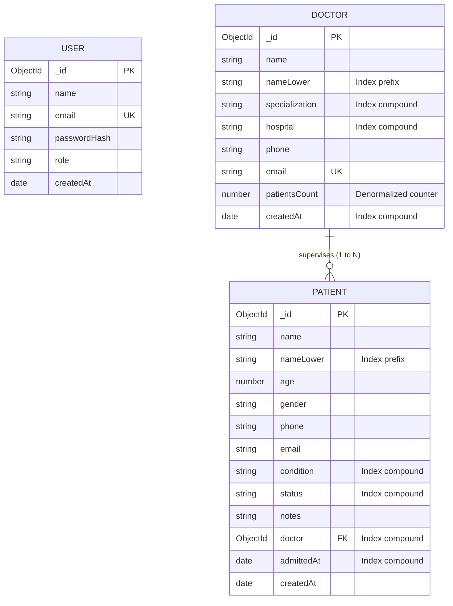

---

## 4. Technical Decisions (Deep Dive)

### Technical Decision 1: httpOnly Cookie JWT Authentication via Next.js Rewrite Proxy

- **Context**: Medical and clinical administration applications process sensitive demographic and healthcare data. The application requires an authentication mechanism that works reliably across server-rendered layouts, edge route guards, and client-side data fetching without exposing auth tokens to client JavaScript.
- **Options Considered**:
  1. *localStorage Bearer Tokens*: Store JWT in `localStorage` and attach `Authorization: Bearer <token>` in Axios interceptors.
  2. *NextAuth.js (Auth.js)*: Integrated Next.js authentication session provider.
  3. *httpOnly Cookie with Next.js Rewrite Proxy*: Standalone Express server issues JWTs in `httpOnly`, `Secure`, `SameSite=Lax` cookies; Next.js proxies `/api/*` to the Express backend.
- **Decision**: **Option 3: httpOnly Cookie with Next.js Rewrite Proxy**.
  - **Security (XSS Prevention)**: Storing JWT tokens in `localStorage` exposes them to any cross-site scripting (XSS) exploit or third-party dependency compromise. `httpOnly` cookies cannot be accessed via JavaScript (`document.cookie`), neutralizing token theft vectors.
  - **Seamless Route Protection**: Next.js Edge Middleware (`middleware.ts`) can read the request cookies directly on incoming HTTP requests before rendering any page components, enabling zero-latency redirects (`/login` -> `/dashboard` or `/portal/*` -> `/login`) without layout flashing or client-side hydration redirects.
  - **Zero CORS / SameSite Headaches**: By utilizing Next.js `rewrites()` in `next.config.ts`, the browser communicates strictly with the Next.js origin (`localhost:3000`). The cookies are same-origin, completely eliminating third-party cookie blocking, Safari ITP restrictions, and complex preflight CORS requirements.
- **Trade-offs & Mitigations**:
  - *Trade-off*: An extra proxy network hop through Next.js for API calls.
  - *Mitigation*: Negligible overhead (<2ms on local/Vercel edge networks). When scaling, reverse proxies like Nginx or Cloudflare can handle the path-based routing directly.

---

### Technical Decision 2: Index-First ESR Query Architecture with URL-Persisted State & TanStack Query

- **Context**: The requirements specify complex real-time search, multi-field filtering (specialization, hospital, condition, status, gender, date ranges), sorting by multiple fields, and paginating over large datasets without incurring expensive database collection scans (`COLLSCAN`).
- **Options Considered**:
  1. *Redux Toolkit / Global State*: Store filter criteria, pagination numbers, and fetched lists in Redux or Zustand.
  2. *Unanchored Regex with Full Collection Search*: Using `{ $regex: term, $options: 'i' }` across fields.
  3. *Index-First Compound ESR (Equality, Sort, Range) + URL-Driven TanStack Query*: Compound indexing on normalized fields, anchored prefix regex (`^term`), denormalized atomic counters, URL query string as single source of truth, and TanStack Query cache.
- **Decision**: **Option 3: Index-First Compound ESR Architecture with URL State**.
  - **No `COLLSCAN` Guarantee**: Normalized lowercase fields (`nameLower`) are indexed. Search uses escaped regex anchored at the beginning (`^${term}`), allowing MongoDB to perform b-tree index lookups (`IXSCAN`) rather than scanning all documents in memory.
  - **ESR Rule Adherence**: Compound indexes (e.g. `{ specialization: 1, createdAt: -1 }` and `{ doctor: 1, admittedAt: -1 }`) follow the Equality-Sort-Range rule, enabling index coverage for filtered and sorted lists.
  - **Denormalized `patientsCount` with Atomic Maintenance**: Doctors store a denormalized `patientsCount` maintained via `$inc: { patientsCount: 1 }` on patient creation and `-1` on deletion or reassignment. This eliminates heavy `$lookup` aggregation joins for physician lists while guaranteeing $O(1)$ sorting by patient load.
  - **URL as Source of Truth**: All search terms, active dropdown filters, sort keys, and page numbers are mirrored into URL parameters (`/doctors?search=dr&specialization=Cardiology&page=2`). Users can bookmark, refresh, and share exact filtered views without state loss.
  - **TanStack Query with `keepPreviousData`**: Eliminates layout jumping and UI flickering during pagination and debounced typing (400ms debounce).
- **Trade-offs & Mitigations**:
  - *Trade-off*: Denormalized counters require strict transactional maintenance on write mutations.
  - *Mitigation*: Service-layer atomic updates ensure that every patient creation, update, deletion, or cascade delete reconciles the corresponding doctor counter immediately.

---

## 5. Visual Evidence

### 1. Clinical Analytics Dashboard
> Executive analytics featuring real-time KPI metrics, patient admission timeline, top physicians by patient load, conditions donut share, and department distribution.

| Desktop View (1280px) | Mobile View (390px) |
|---|---|
| 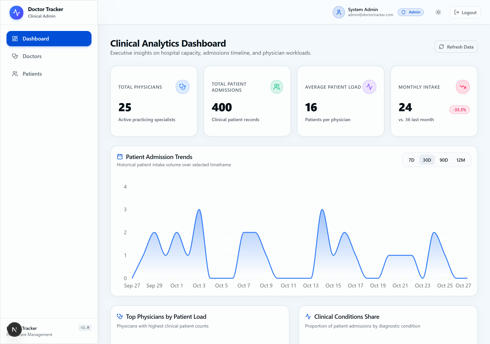 | 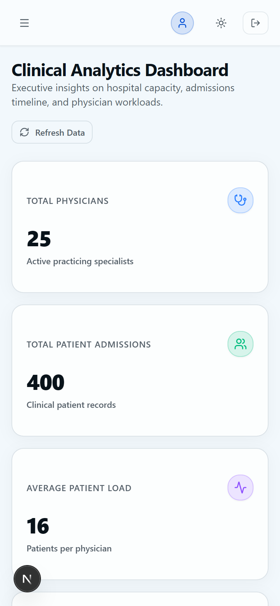 |

---

### 2. Doctors Directory
> Physician directory with debounced search, specialization/hospital filters, sorting, table/grid view toggle, and pagination.

| Desktop View (1280px) | Mobile View (390px) |
|---|---|
| 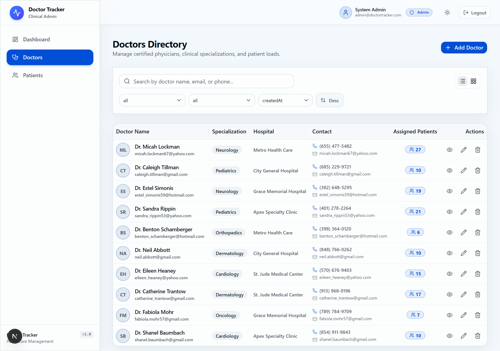 | 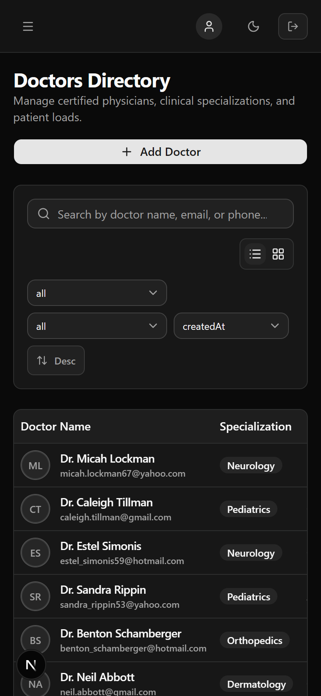 |

---

### 3. Doctor Clinical Profile & Assigned Patients
> Physician detail profile displaying clinical information, active patient workload badge, and doctor-scoped patient management with cascade delete confirmation.

| Desktop View (1280px) | Mobile View (390px) |
|---|---|
| 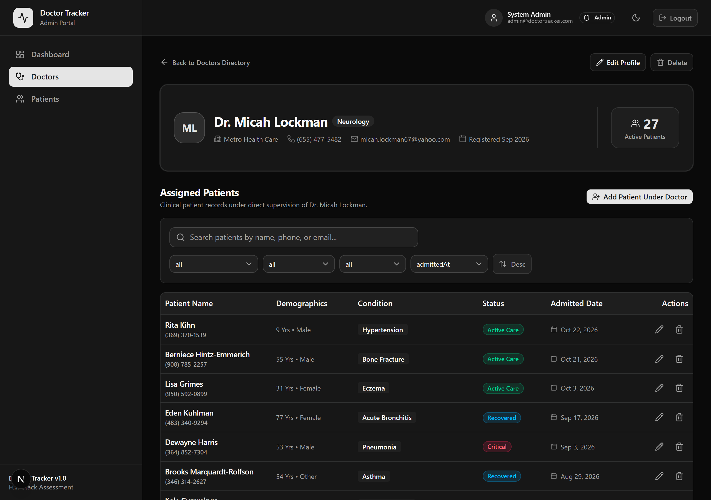 | 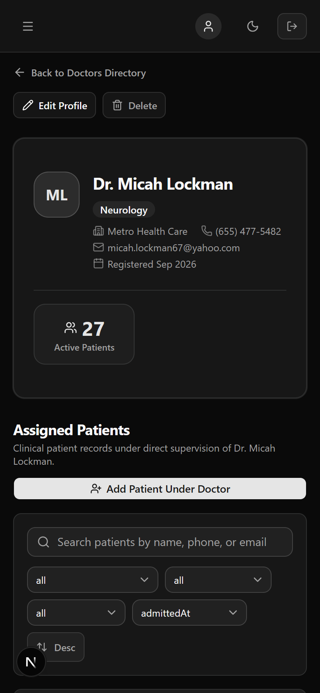 |

---

### 4. Patients Registry
> Centralized patient care directory with demographic filtering, condition badges, admission date formatting, and assigned doctor links.

| Desktop View (1280px) | Mobile View (390px) |
|---|---|
| 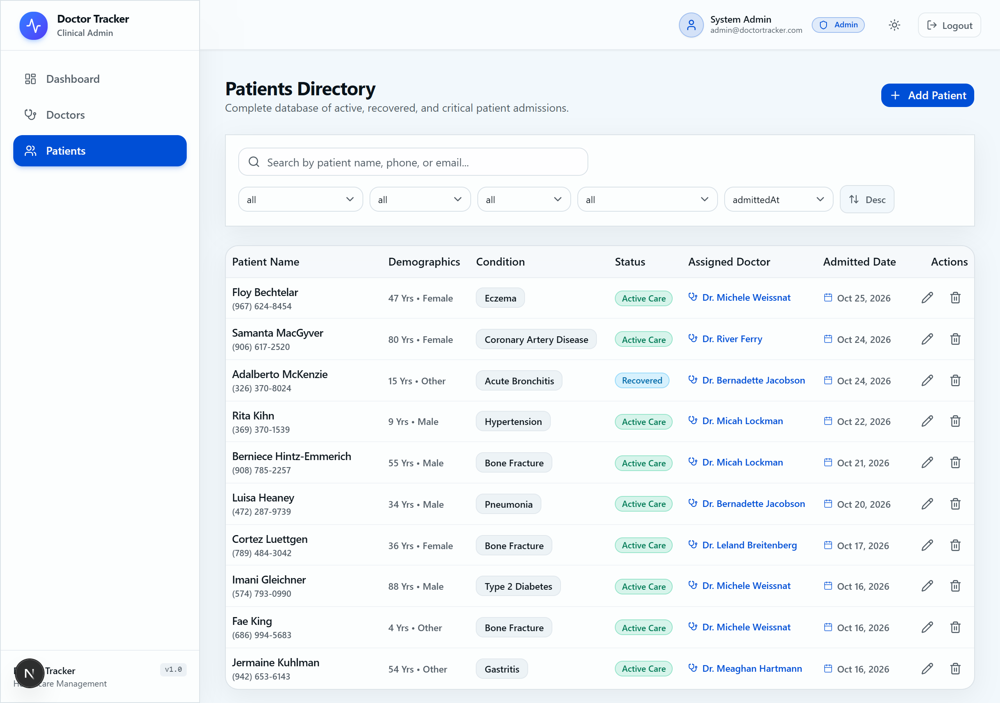 | 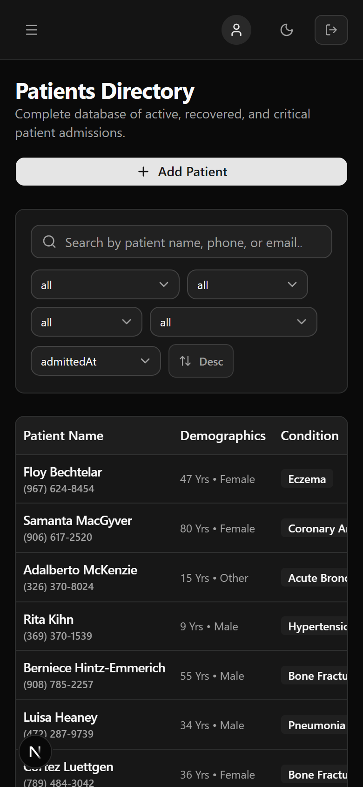 |

---

### 5. Authentication Screen
> Secure login portal with input validation, password toggle, rate-limiting protection, and 1-click demo credential quick-fill.

| Desktop View (1280px) | Mobile View (390px) |
|---|---|
| 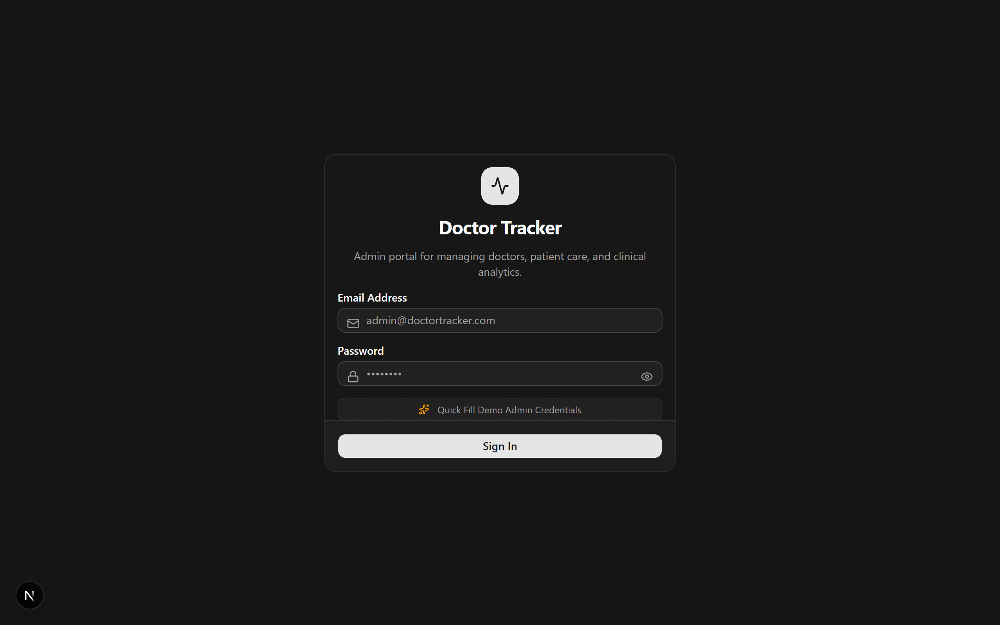 | 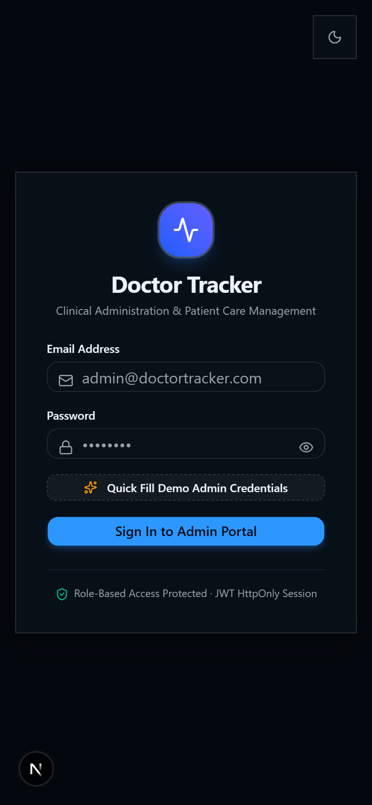 |

---

## 6. API Endpoint Summary

All API endpoints reside under `/api/v1` and return the unified response envelope:

| Method | Endpoint | Description | Auth Required |
|---|---|---|---|
| `GET` | `/health` | Unauthenticated uptime health check | No |
| `POST` | `/api/v1/auth/login` | Login admin, sets httpOnly cookie | No (Rate Limited) |
| `POST` | `/api/v1/auth/logout` | Clears authentication cookie | Yes |
| `GET` | `/api/v1/auth/me` | Fetch currently authenticated user session | Yes |
| `GET` | `/api/v1/doctors` | Paginated doctors with search, filters, and sort | Yes |
| `POST` | `/api/v1/doctors` | Register new doctor (validates email uniqueness) | Yes |
| `GET` | `/api/v1/doctors/filters` | Distinct specializations and hospitals | Yes |
| `GET` | `/api/v1/doctors/:id` | Fetch single doctor clinical details | Yes |
| `PATCH` | `/api/v1/doctors/:id` | Update doctor profile and contact information | Yes |
| `DELETE` | `/api/v1/doctors/:id` | Delete doctor (blocked if has patients unless `?cascade=true`) | Yes |
| `GET` | `/api/v1/doctors/:id/patients` | Paginated list of patients under specific doctor | Yes |
| `POST` | `/api/v1/doctors/:id/patients` | Add patient directly under doctor | Yes |
| `DELETE` | `/api/v1/doctors/:id/patients/:patientId` | Remove patient from doctor | Yes |
| `GET` | `/api/v1/patients` | Paginated patients with populated doctor and filters | Yes |
| `POST` | `/api/v1/patients` | Register patient (atomically increments doctor count) | Yes |
| `GET` | `/api/v1/patients/filters` | Distinct conditions, statuses, and genders | Yes |
| `GET` | `/api/v1/patients/:id` | Single patient detail | Yes |
| `PATCH` | `/api/v1/patients/:id` | Update patient (handles doctor reassignment counts) | Yes |
| `DELETE` | `/api/v1/patients/:id` | Delete patient (atomically decrements doctor count) | Yes |
| `GET` | `/api/v1/analytics/summary` | KPI metrics (doctors, patients, monthly trend %) | Yes |
| `GET` | `/api/v1/analytics/patients-per-doctor` | Top 10 doctors by patient load | Yes |
| `GET` | `/api/v1/analytics/timeline` | Zero-filled admissions over 7d/30d/90d/12m | Yes |
| `GET` | `/api/v1/analytics/conditions` | Clinical condition distribution with percentage share | Yes |
| `GET` | `/api/v1/analytics/specializations` | Physician counts per specialization department | Yes |

---

## 7. Assumptions & Technical Decisions

1. **Monorepo Architecture Choice**: The assessment specifications mentioned both an integrated Next.js API route model and a decoupled Express REST backend. We deliberately implemented a **monorepo with separate client and server packages** to demonstrate industry-standard separation of concerns, strict REST query optimization, middleware layering, and independent horizontal scalability.
2. **Referential Integrity Enforcement**: Doctors cannot be deleted if they have active patients assigned to them (returning HTTP 409 Conflict). A `?cascade=true` query parameter and interactive modal checkbox allow administrators to deliberately delete associated patient records when necessary.
3. **Analytics Zero-Filling**: The `/analytics/timeline` endpoint explicitly generates zero-filled buckets for days/months with zero admissions, guaranteeing that visual charts maintain a continuous, accurate time axis.
4. **Denormalized Counter Reconciliation**: Doctor `patientsCount` is maintained atomically on every mutation. A recount utility is included to verify data consistency.

---

## 8. Scalability & Future Roadmap

- **MongoDB Atlas Search / Elasticsearch**: While anchored prefix regex on `nameLower` achieves $O(\log N)$ performance over standard b-tree indexes, integrating Atlas Search (Lucene) would enable full-text fuzzy matching, typo tolerance, and acoustic searching (Metaphone).
- **Cursor / Keyset Pagination**: For collections exceeding $10^6$ records, transitioning from offset-based pagination (`skip`/`limit`) to keyset pagination (`_id < lastSeenId`) prevents deep-offset scan penalties.
- **Distributed Redis Caching**: Replacing in-memory caching with Redis clusters to share cache invalidation across horizontally scaled Node.js API instances.
- **Audit Logging**: Storing immutable audit logs for clinical records compliance (HIPAA).
